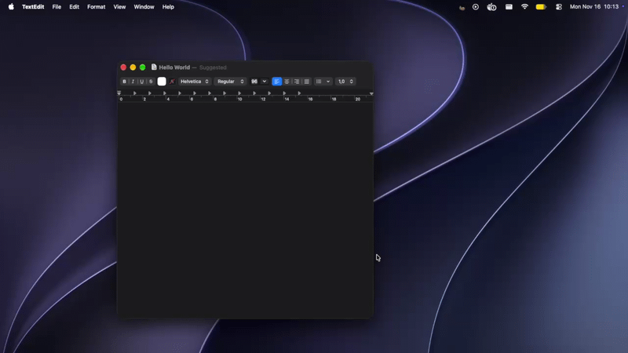

<p align="center">
  
</p>

<h1 align="center">Clipboard v1.0.3</h1>

Clipboard pratik bir clipboard yöneticisi.


- Kopyaladığınız içerikleri otomatik olarak kaydeder.
- Clipboard geçmişinizi kolayca görüntüleyebilirsiniz.
- Önceden kopyaladığınız içeriklere hızlıca erişebilirsiniz.
- **macOS Menü Çubuğu Entegrasyonu:** Menü çubuğundaki uygulama simgesi üzerinden clipboard geçmişinize hızlıca erişebilirsiniz.

<p align="center">
  
</p>

### İndirme ve Kurulum

Releases Bölümünden uygun dosyayı indirin:

- **macOS:** `.dmg`
- **Windows:** `.exe`
- **Linux:** `.AppImage`

Kurulum adımlarını takip ederek Clipboard'ı kullanmaya başlayabilirsiniz.

#### 🍎 macOS: "Uygulama açılamıyor" uyarısı

Uygulama Apple tarafından imzalanmadığı için, başka bir Mac'te ilk açılışta macOS güvenlik nedeniyle uygulamayı engelleyebilir. Bu durumda izin vermeniz gerekir:

1. `.dmg` dosyasını açın ve Clipboard'ı **Uygulamalar** klasörüne sürükleyin.
2. Uygulamayı açmayı deneyin. Uyarı çıktığında **Tamam**'a tıklayın.
3. **Sistem Ayarları → Gizlilik ve Güvenlik** bölümüne gidin.
4. Aşağı kaydırıp **Güvenlik** başlığı altında "Clipboard engellendi" mesajının yanındaki **Yine de Aç** düğmesine tıklayın.
5. Parolanızı veya Touch ID'nizi doğrulayın ve **Aç**'a tıklayın.

Bu işlem yalnızca bir kez gereklidir; sonraki açılışlarda uygulama normal şekilde açılır.

Uygulama hâlâ "hasarlı" veya "açılamıyor" hatası veriyorsa Terminal'de aşağıdaki komutu çalıştırıp tekrar deneyin:

```bash
xattr -cr /Applications/Clipboard.app
```

İlk sürümümüzü denediğiniz için teşekkürler!